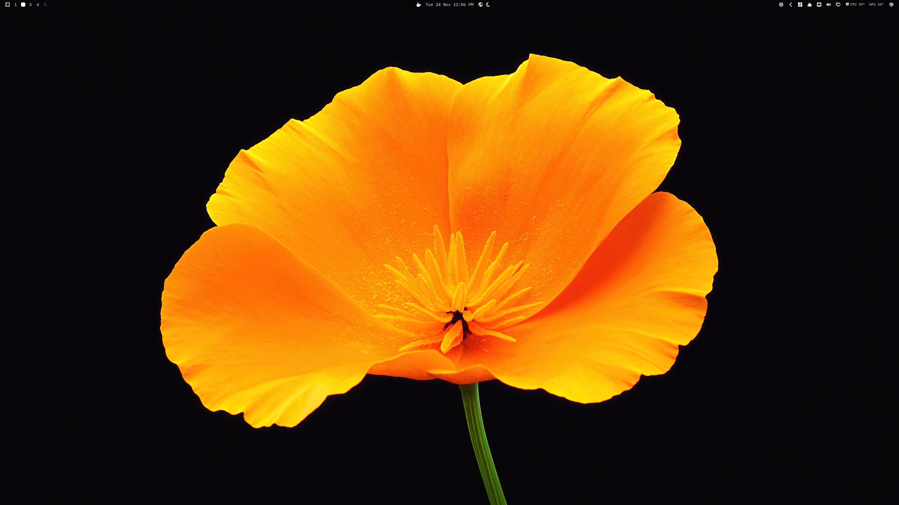
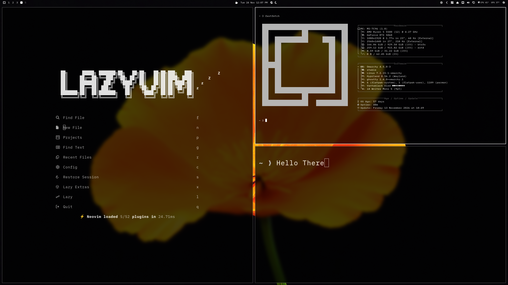
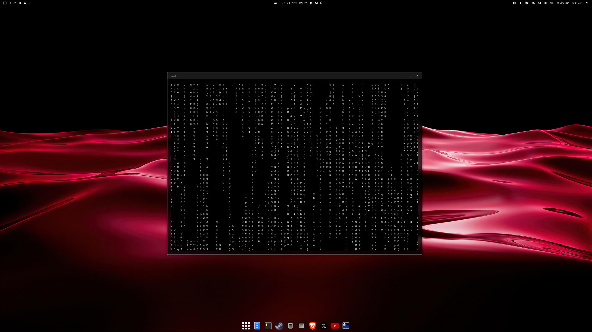
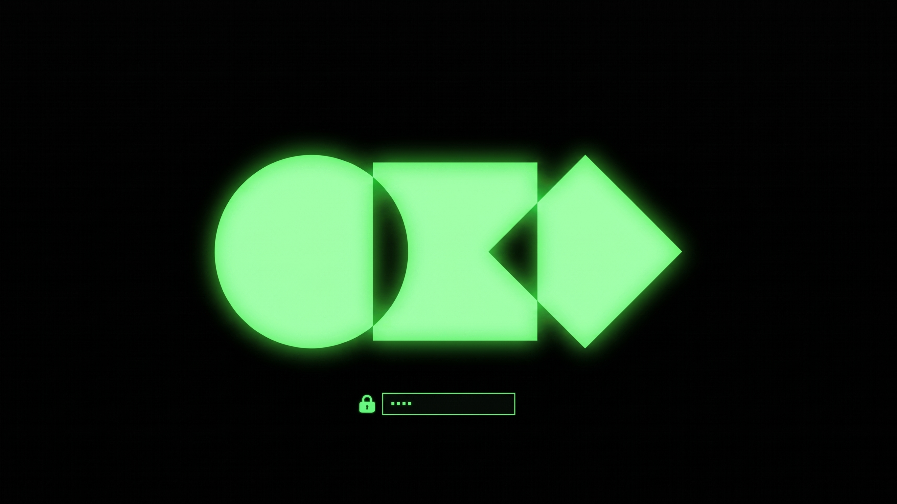

# Vantablack OLED

A pure-black `#000000` [Omarchy](https://omarchy.org) theme built for OLED displays, pairing Vantablack surfaces with soft white (`#e8e8e8`) accents, 12 curated OLED wallpapers, and a neon-green Plymouth unlock screen.



## Showcase






## Lock / Unlock Screen



## Install

```bash
omarchy theme install https://github.com/AdamIshbib/vantablack-oled
```

Apply or reapply anytime with:

```bash
omarchy theme set vantablack-oled
```

To also apply the neon-green OLED unlock screen to Plymouth and SDDM:

```bash
omarchy plymouth set by theme vantablack-oled
```

## Included

- `colors.toml` — Pure `#000000` background, `#ffffff` foreground, `#e8e8e8` soft-white accent, and crisp greyscale ANSI tones.
- `icons.theme` — `Yaru-gray` icon theme.
- `backgrounds/` — 12 pure-black OLED wallpapers. Cycle them with `omarchy theme bg next` or pick via `SUPER + CTRL + SPACE`.
- `preview.png` — Theme switcher preview (`2560×1440`).
- `preview1.png`, `preview2.png`, `preview3.png` — Desktop showcase screenshots.
- `unlock.png` & `preview-unlock.png` — Custom neon-green OLED Plymouth unlock logo (`800×378` RGBA) and preview.

## Palette

| Role | Hex |
| :--- | :--- |
| **Background** | `#000000` |
| **Dark Background** | `#090909` |
| **Darker Background** | `#070707` |
| **Lighter Background** | `#1a1a1a` |
| **Foreground** | `#ffffff` |
| **Accent** | `#e8e8e8` |
| **Muted** | `#7a7a7a` |
| **Selection** | `#1a1a1a` |
